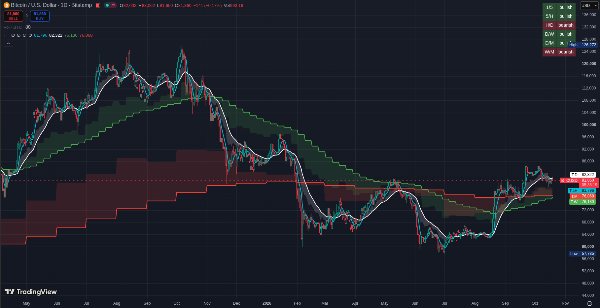
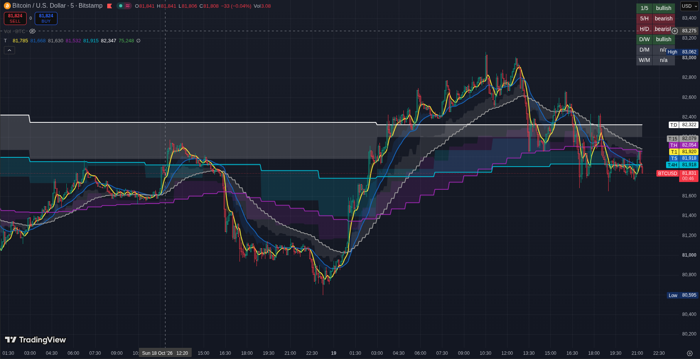

# Multi-Timeframe EMA (TradingView, Pine Script v6)

A TradingView indicator that plots the **same EMA (default length 27) on 8 timeframes at once**, on any chart timeframe. Each EMA is calculated from the candles of **its own timeframe** (1m, 5m, 15m, 1H, 4H, 1D, 1W, 1M), not from the candles of the chart you are looking at.

On top of the lines it adds:

- a **velocity fill** that shows which way, and how fast, each EMA is moving
- a **crossover table** that shows whether pairs of EMAs are bullish or bearish
- an **adaptive timeframe** option that hides the small timeframes on higher charts
- a **manual fallback** for weekly/monthly values when the chart has too little history

> Not financial advice. This is a charting tool.

---

 

## Features

| Feature | What it does |
|---|---|
| Multi-timeframe EMAs | 8 EMAs (1, 5, 15, H, 4H, D, W, M), each on its own timeframe's candles |
| Last closed candle | Each line shows the EMA of the last **closed** candle of its timeframe. It stays flat until that candle closes and does not repaint |
| Per-line settings | Checkbox and color for every EMA, laid out in 3 rows |
| Adaptive timeframe | Automatically hides the smaller timeframes on higher charts |
| Velocity fill | Fills the space between each EMA and `EMA + velocity * strength` |
| Crossover table | Bullish / bearish / n/a for 6 EMA pairs, with adjustable position and transparency |
| Manual fallback | Lets you type W/M EMA values per ticker when TradingView does not load enough bars |

---

## Installation

1. Open a chart on [TradingView](https://www.tradingview.com).
2. Open the **Pine Editor** (bottom panel).
3. Paste the contents of `mtma.pine` into the editor, replacing the default code.
4. Click **Save**, then **Add to chart**.

---

## How to use it

### The lines

Each EMA is drawn with its tag as the name:

| Tag | Timeframe | Default color |
|---|---|---|
| 1 | 1 minute | yellow |
| 5 | 5 minutes | dark blue |
| 15 | 15 minutes | gray |
| H | 1 hour | purple |
| 4H | 4 hours | aqua |
| D | 1 day | white |
| W | 1 week | green |
| M | 1 month | red |

Because each line uses the last closed candle of its own timeframe, a higher-timeframe EMA looks like a staircase: it is flat while its candle is open and steps when the candle closes.

### Settings

**Inputs**

- **EMA Length**: the EMA length, applied to every timeframe (default 27).

**EMAs**

- A checkbox and a color for each of the 8 EMAs.
- **Adaptive timeframe**: when on, small timeframes are hidden on higher charts so the chart stays readable:

  | Chart timeframe | Hidden lines |
  |---|---|
  | 15m | 1 |
  | 1H or 4H | 1, 5, 15 |
  | 1D | 1, 5, 15, H |
  | 1W and above | 1, 5, 15, H, 4H |

  The D, W and M lines are never hidden by this option.

**Velocity**

- **Show velocity fill**: turns the fills on or off.
- **Velocity strength** (default 5): multiplies the velocity.
- **Velocity transparency** (default 85): transparency of the fill, using the same color as the EMA.

*Velocity* is the EMA of the last closed candle minus the EMA of the candle before it, measured on the EMA's own timeframe. The fill is drawn between the EMA and `EMA + velocity * strength`: a fill above the line means the EMA is rising, below means it is falling, and a wider fill means faster movement.

**Table**

- **Show crossover table**, **Table position** (9 positions), **Table transparency** (default 65).

**Manual fallback** (at the bottom)

- See [Manual fallback](#manual-fallback) below.

### The crossover table

| Pair | Compares |
|---|---|
| 1/5 | 1m EMA vs 5m EMA |
| 5/H | 5m EMA vs 1H EMA |
| H/D | 1H EMA vs 1D EMA |
| D/W | 1D EMA vs 1W EMA |
| D/M | 1D EMA vs 1M EMA |
| W/M | 1W EMA vs 1M EMA |

Each row is colored:

- **Green, "bullish"**: the smaller-timeframe EMA is above the larger one (it last crossed up).
- **Red, "bearish"**: the smaller-timeframe EMA is below the larger one (it last crossed down).
- **Gray, "n/a"**: one of the two EMAs has no data.

The table shows the *current state*, not only the moment of the cross. It ignores the checkboxes and the adaptive option, so a pair is shown even if one of its lines is hidden.

### Manual fallback

TradingView loads a limited number of bars per chart (about 5,000 on the free plan and 20,000 on premium plans). On low timeframes such as the 1m chart, there may not be enough weekly or monthly history to calculate those EMAs, and they show as n/a.

For W and M only, you can type the values yourself. In the **Manual fallback** box, write one ticker per line:

```
TICKER,1W,1M
```

For example:

```
BTCUSDT,61800,48300
AAPL,221.7,205.1
```

- The ticker is the symbol **without the exchange**, written exactly as TradingView writes it (for example `BTCUSDT`, or `BTCUSDT.P` for perpetual futures).
- The values are used only when the real EMA is n/a, and they plot as flat lines.
- Lines with `0` or text instead of a number are ignored.
- Get the values by opening a daily or higher chart (where enough history loads) and reading the EMA values there. Update them when the week or month rolls over.
- Manual values have no velocity, so no fill is drawn for them.

---

## Alerts

All 8 EMAs are normal plots, so you can use TradingView's built-in alerts. Create an alert (the alarm clock icon, or `Alt + A`), then in the condition fields choose this indicator's plots.

**Price crossing an EMA**

- Set the condition to the price series (for example **Close**), choose **Crossing**, **Crossing Up** or **Crossing Down**, and pick the EMA plot (`1`, `5`, `15`, `H`, `4H`, `D`, `W` or `M`) as the second series.
- Or do it the other way around: the EMA plot first, then crossing, then **Close**.

**An EMA crossing another EMA**

- Set the first condition to one EMA plot (for example `D`), choose **Crossing Up** or **Crossing Down**, and pick another EMA plot (for example `W`) as the second series.
- This works for any two timeframes, not only the 6 pairs shown in the table.

Tips:

- Do not use the plots named `... target`; they belong to the velocity fill.
- The exact labels in the alert window can differ slightly between TradingView versions.
- Choosing **Once Per Bar Close** is the safest trigger option.

---

## How it works

- Each EMA is requested with `request.security`, using `ta.ema(close, len)[1]` with `lookahead=barmerge.lookahead_on`. This returns the EMA of the **last closed candle** of that timeframe, which is why the lines do not repaint and stay flat until the higher candle closes.
- `ta.ema` returns n/a until it has enough bars of that timeframe. That is how missing history shows up (gray in the table, and nothing drawn).
- Velocity is calculated in the same request, on the EMA's own timeframe: `e[1] - e[2]`.
- The script uses 8 `request.security` calls; TradingView allows up to 40.
- **Only closed candles are used, by design.** A timeframe equal to or lower than the chart's is also read from its last closed candle, so it trails by one candle of its own timeframe and never uses an incomplete candle.

**Known limits**

- On low-timeframe charts, weekly and monthly EMAs may be n/a. Use the manual fallback or a higher-timeframe chart.

---

## Customizing

Open the script in the Pine Editor and edit it. Names below are the variable names in the code.

### Change the default EMA length
Edit `len = input.int(27, "EMA Length", minval=1)`. You can also change it in the settings without touching the code.

### Change default colors
Edit the colors in the `colXX = input.color(...)` lines, for example `color.new(#ffeb3b, 0)`.

### Change the adaptive timeframe rules
Edit the `hideXX` lines. `cs` is the chart timeframe in seconds (900 = 15m, 3600 = 1H, 86400 = 1D, 604800 = 1W):

```pine
hide1m  = adaptive and cs >= 900
hide5m  = adaptive and cs >= 3600
hide15m = adaptive and cs >= 3600
hide1h  = adaptive and cs >= 86400
hide4h  = adaptive and cs >= 604800
```

### Change the crossover pairs
Edit the three arrays in the table section. They are aligned by position, so the first entry of each array is one row:

```pine
pairs = array.from("1/5", "5/H", "H/D", "D/W", "D/M", "W/M")
fast  = array.from(ema1m, ema5m, ema1h, ema1d, ema1d, ema1w)
slow  = array.from(ema5m, ema1h, ema1d, ema1w, ema1M, ema1M)
```

If you add or remove rows, also change the row count in `table.new(tblPos, 2, 6, ...)` and the loop `for i = 0 to 5`.

### Change the velocity formula
`f_pair()` returns the EMA and its velocity. The target line of each fill is `EMA + velocity * velStrength`, found in the `tXX = plot(...)` lines.

```pine
f_pair() =>
    e = ta.ema(close, len)
    [e[1], e[1] - e[2]]
```

### Use a different timeframe, or add one
To change a timeframe, change the string in its call, for example `f_ema("60")` to `f_ema("30")`, and rename its tag.

To add one (for example 30 minutes):

1. Add its inputs: `show30m` and `col30m` (copy an existing pair of lines).
2. Add the call: `[ema30m, vel30m] = f_ema("30")`.
3. Add its visibility: `vis30m = show30m`.
4. Copy a plot block (`p`, `t` and `fill` lines) and rename it for `30m`.

Timeframe strings: minutes are plain numbers (`"1"`, `"60"`, `"240"`), and `"D"`, `"W"`, `"M"` are day, week and month.
